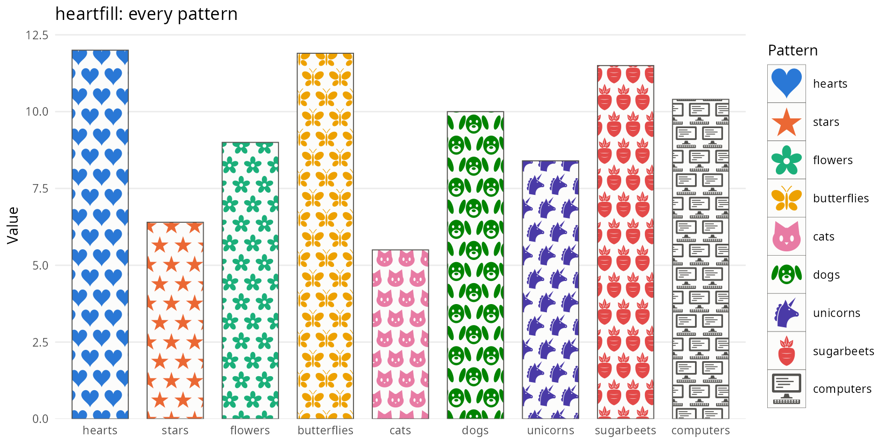

# heartfill

Novelty fill patterns for **ggplot2** bar plots (and any other
[ggpattern](https://coolbutuseless.github.io/package/ggpattern/) geom):
hearts, stars, flowers, butterflies, cats, dogs, unicorns, sugar beets and
computers.



The patterns plug into `ggpattern`: loading `heartfill` registers them, so you
use them with `pattern = "hearts"` etc. in `geom_col_pattern()`,
`geom_bar_pattern()`, `geom_area_pattern()`, …

## Installation

Requires R >= 4.1 with `ggplot2` and `ggpattern` (which brings `gridpattern`).

```bash
# from the directory containing the package folder
R CMD INSTALL heartfill
```

If `ggpattern` is missing: `conda install -c conda-forge r-ggpattern`.

## Usage

```r
library(ggplot2)
library(ggpattern)
library(heartfill)   # registers the patterns

df <- data.frame(group = c("A", "B", "C"), value = c(5, 9, 3))

ggplot(df, aes(group, value)) +
  geom_col_pattern(
    aes(pattern_fill = group),   # one shape colour per bar
    pattern = "hearts",
    pattern_angle = 0,           # ggpattern tilts patterns 30° by default
    pattern_colour = NA,         # no outline on the shapes
    pattern_spacing = 0.06,
    pattern_density = 0.75,
    fill = "white"               # bar background
  )
```

### Available patterns

| `pattern =`     | Shape function       | Shape options                  |
|-----------------|----------------------|--------------------------------|
| `"hearts"`      | `heart_shape()`      | `n`                            |
| `"stars"`       | `star_shape()`       | `points`, `inner`              |
| `"flowers"`     | `flower_shape()`     | `petals`, `depth`, `centre`    |
| `"butterflies"` | `butterfly_shape()`  | `antenna_width`                |
| `"cats"`        | `cat_shape()`        | `eyes`                         |
| `"dogs"`        | `dog_shape()`        | `face`                         |
| `"unicorns"`    | `unicorn_shape()`    | `mane`, `face`, `m`            |
| `"sugarbeets"`  | `sugarbeet_shape()`  | `leaves`, `details`, `m`       |
| `"computers"`   | `computer_shape()`   | `screen`, `keyboard`           |

Each pattern draws its shape function's defaults. Holes in a shape (flower
centres, cat, dog and unicorn faces, gaps between butterfly parts and around
the unicorn's horn and mane, beet leaf veins and rings, computer screens and
keys) let the bar fill show through.

### Text fills

`text_pattern(text, angle)` fills with repeated text in staggered rows at any
angle. It registers the pattern and returns its name:

```r
ggplot(df, aes(group, value)) +
  geom_col_pattern(
    pattern = text_pattern("hello", 45),   # also: fontface, family
    pattern_fill = "#2a78d6",              # text colour
    pattern_spacing = 0.04,                # row spacing
    pattern_density = 0.7,                 # text height relative to spacing
    fill = "white"
  )
```

For a different text per bar, map `pattern` and pass the names to
`scale_pattern_manual()`; see `inst/examples/text_barplot.R`. The text's own
`angle` is used (`pattern_angle` is ignored). Registration lasts for the
session, so re-run `text_pattern()` before redrawing a saved plot later.

### Settings

| Setting           | What it does                                          | ggpattern default |
|-------------------|-------------------------------------------------------|-------------------|
| `pattern_fill`    | shape colour (fixed, or mapped in `aes()`)            | grey              |
| `pattern_colour`  | shape outline (`NA` for none)                         | grey              |
| `pattern_spacing` | step between shapes along their longer side, as a fraction of the panel | 0.05 |
| `pattern_density` | shape size relative to the spacing                    | 0.2 (try 0.75)    |
| `pattern_angle`   | rotation in degrees                                   | 30 (use 0)        |
| `pattern_alpha`   | transparency                                          | 1                 |
| `pattern_xoffset`, `pattern_yoffset` | shift the grid                     | 0                 |

The grid follows each shape's proportions with an even gap between shapes, so
wide shapes get closer rows and tall shapes closer columns. Wide shapes
(butterflies, dogs) and tall ones (unicorns, sugar beets) may still look best with a
slightly larger `pattern_spacing` or `pattern_density`.

Choose colours for a mapped `pattern_fill` with
`scale_pattern_fill_manual(values = ...)`. To give each bar its own shape, map
`pattern` as well and add `scale_pattern_manual()`; see
`inst/examples/all_patterns_barplot.R`.

## Examples

Runnable demo scripts ship with the package:

```r
list.files(system.file("examples", package = "heartfill"), full.names = TRUE)
```

Each writes a PNG (optionally to a path given as the first command-line
argument), e.g.

```bash
Rscript "$(Rscript -e 'cat(system.file("examples/all_patterns_barplot.R", package = "heartfill"))')" my_plot.png
```

## Adding a pattern

1. Write a function returning the outline as `list(x, y)` scaled to fit
   `[-0.5, 0.5]`, optionally with an `id` vector to split it into sub-paths
   (sub-paths are combined with the even-odd rule, so a sub-path inside
   another becomes a hole; keep separate parts from overlapping).
2. Add a pattern function that calls the shared tiler:
   ```r
   create_pattern_foo <- function(params, boundary_df, aspect_ratio, legend = FALSE) {
     tile_shape_pattern(params, boundary_df, legend, foo_shape(), "foo")
   }
   ```
3. Register it in `heartfill_patterns()` in `R/zzz.R`, then re-document
   (`roxygen2::roxygenise()`) and reinstall.

## License

MIT
